# Design — Policy Playground

## Document Information

- **Feature Name**: Policy Playground
- **Version**: 1.2 (revision under review; 1.0 approved before Tasks were drafted)
- **Status**: Design 1.0 approved; Tasks drafted from it. Revisions 1.1 and 1.2 (see *Revision History*) await approval. No implementation has started.
- **Source of truth**: `.kiro/specs/policy-playground/requirements.md` (Requirements 1.2, R1–R16 + NFRs, including the team *Decision Log*)
- **Concrete reference fixture**: `fixtures/policy-playground-demo-policy.json` + `fixtures/policy-playground-demo-policy-README.md` (100% synthetic; not real credit-policy platform data)

> **Reuse note (Design directive 1).** The pre-existing `design.md` was empty on disk, so there was nothing to reuse; this document is authored fresh. No prior design was discarded.

> **Grounding note.** Kiro has no access to the credit-policy platform. Everything about the platform's real implementation (study execution, repositories, skills, identity, `Motivo de Decisão`) is treated as unverified and marked `[Confirmar: contrato real]` or carried as an open question. The synthetic fixture is used only to make the contract and flows concrete; no numeric experiment result is invented.

---

## 1. Visão geral e objetivos do design

Policy Playground lets a credit policy specialist load a consolidated **Policy Spec** (a structured JSON like the fixture), explore its rules/variables/DAG, change a parameter or state a hypothesis in natural language, build an **experimental scenario** that never touches the baseline, run it through a **deterministic execution** that is the only source of impact numbers, compare scenario vs. baseline with traceable evidence, receive a **bounded set of AI suggestions** each carrying an explicit evidence level (none / simulated / study-validated), and decide what advances. Code/test/PR generation is the demonstrative tail, feasibility-gated.

**Design objectives, in priority order:**

1. **Determinism and trust.** AI never produces an impact number. The impact comes from a deterministic executor over the policy chain; AI output and calculated results live in separate, separately-labeled data (R5, R7).
2. **Human control.** Every modification is confirmed by a human before it enters a scenario; nothing auto-advances to a committed change or production (R4, R10, R12).
3. **Minimal sufficient architecture.** A single application (web UI + one backend) with internal modules for the six responsibility boundaries, not six services. Deterministic execution and credit-policy platform integration sit behind one adapter interface so the MVP can run on the fixture and swap in real credit-policy platform later (directive in §3 of the task; requirements "most simple solution").
4. **Traceability by construction.** Hypothesis → parameters → policy version → scenario → execution → result/evidence → finding → human decision are linked records (R14).

### Design directives carried from Requirements approval

| # | Directive | Where addressed |
|---|-----------|-----------------|
| 1 | Inspect pre-existing `design.md` before reuse | Reuse note above (was empty) |
| 2 | Investigate Policy Spec JSON origin/owner/availability | §6, §15, OQ-2/OQ-15 |
| 3 | Design generic impact-analysis capability, fixture as functional reference | §9 |
| 4 | Reverse dependency discovery + DAG execution in valid order | §7, §8 |
| 5 | Validate full demonstrative journey (code/tests/PR) without assuming it is solved | §9 (deterministic tail), §15 risk R-6, OQ-9 |

---

## 2. Escopo do MVP e exclusões

**No design scope (MVP):**

- Load + validate a Policy Spec JSON (R16); explore rules, variables, parameters, DAG, motivos (R1).
- Hybrid interaction: visual parameter edit + natural-language hypothesis (R2, R3).
- Human confirmation of any AI-proposed modification (R4).
- Build an isolated scenario as an overlay on the baseline (R5.9).
- Deterministic impact execution behind an adapter, with a **clearly-labeled simulated executor** for the fixture as the MVP fallback (R5.5, R5.8).
- Baseline-vs-scenario comparison as a reusable capability (R6).
- Reverse dependency discovery from a changed parameter / objective, over the Policy Spec DAG (R5.3, R5.4).
- Bounded AI suggestions with explicit evidence-level labeling (none / simulated / study-validated) (R7, R8).
- Deterministic candidate findings derived from the Policy Spec beyond the changed path, ranked with the specialist's relevance feedback (R8.5, R8.6; §10.3).
- Instrumented in-app hypothesis-to-evidence time and relevant-finding share (Primary-objective NFR 2–3; §12).
- Deployment on AWS as one containerized, stateless backend on Amazon ECS Fargate, horizontally scalable (§16, team decision D-Q7).
- Persisted investigation state and an append-only audit data lake (§12, team decisions D-Q8, D-Q9).
- Asynchronous, idempotent deterministic execution with status polling and result reuse (§9.4).
- Decision outcomes Accept / Reject / Defer, immutable and superseded rather than edited (§11).
- Finding → scenario (R9); accept/reject + human decision (R10).
- Investigation audit trail (R14); governed-access and model-privacy design posture (R15).

**Explicitly excluded (MVP):**

- Generating/consolidating the Policy Spec itself (R16 scope note).
- Creating new deterministic studies.
- Any production change, merge, or deploy (R12.2).
- Executing arbitrary model-generated expressions (fixture README limit; §7).
- Code/test/PR generation is **designed for feasibility** here but implementing it is the demonstrative tail, gated by OQ-9 and risk R-6 — not assumed solved.

---

## 3. Princípios e decisões arquiteturais

| ID | Decisão | Justificativa (requisito) | Alternativa descartada |
|----|---------|---------------------------|------------------------|
| D-1 | **Single application**: SPA front-end + one backend API, modular monolith. | "solução mais simples"; MVP demonstrativo. R1–R16 não exigem múltiplos serviços. | Microsserviços por boundary — custo sem demanda. |
| D-2 | **Policy Spec is the single structured source of context**; everything (UI, discovery, execution) reads the same loaded+validated model. | R16, R1, R5.3. | Reconstruir política a cada investigação — proibido por R16.3. |
| D-3 | **Deterministic execution behind one `ImpactStudyRunner` adapter interface.** MVP ships a `SimulatedRunner` (fixture) + leaves a `RealStudyRunner` seam. | R5.2 (capacidade genérica, arquivo atual é referência), R5.5/5.8 (real preferido, fallback rotulado). | Acoplar ao `analise de impacto de estudos` como API — proibido por R5.2. |
| D-4 | **AI is advisory only and physically separated from calculation.** The orchestrator may call the runner but may never write a result value; results carry `source: deterministic`, AI output carries `source: ai_suggestion`. | R5.10, R7. | IA calcular/estimar impacto — proibido. |
| D-5 | **Scenario = immutable baseline + parameter overrides (diff).** Baseline is never mutated. | R4.4, R5.9, R6. | Editar o modelo carregado — perderia o baseline. |
| D-6 | **Rule logic is interpreted by a closed, typed evaluator** supporting only the known logic types (`json_extract`, `case_when`, `matrix_lookup`); no arbitrary expression execution. | fixture README; R5.1; segurança §12. | Avaliar expressões SQL-like livres ou código do modelo — risco de segurança. |
| D-7 | **Everything is an append-only investigation record** linking hypothesis→params→policy version→execution→result→finding→decision. | R14. | Estado efêmero — quebraria auditoria. |
| D-8 | **Governed access via an injected authorization boundary**, simplified role set for the demo, not a full IdP. | R15 scope note. | Construir plataforma de identidade — fora de escopo. |
| D-9 | **Deploy the modular monolith as one container image on Amazon ECS Fargate** (§16): one API service with at least two tasks across two Availability Zones, plus on-demand runner tasks from the same image; Amazon Bedrock as the model endpoint with Guardrails at the model boundary. | D-1 stays: one codebase, one image. Team decision D-Q7 (containers on ECS Fargate). Runner tasks keep long executions off the request path (NFR Scalability 3). | One Lambda function — limited execution time for real studies (C1) and diverges from the team decision. Microservices per boundary — cost without demand at 10–50 users. |
| D-10 | **Candidate findings come first from deterministic analysis of the Policy Spec** (shared-input neighbours, branch reachability), and the model only ranks, phrases, or adds suggestions on top. | R8.5 (discovery beyond the changed path), D-4 (model never the source of facts). | Depender só do modelo para encontrar conflitos — não é reprodutível nem testável. |
| D-11 | **Stateless backend; all state in Amazon DynamoDB; every event also written to an append-only S3 audit lake.** In local development the same repository interface is backed by memory. | NFR Scalability 2, R14.4–14.5; team decisions D-Q8, D-Q9. | State in application memory — breaks horizontal scaling and loses history on restart. |
| D-12 | **Deterministic execution is an asynchronous job with an idempotency key** = hash(policy version, overrides, dataset version, runner version). A repeated key reuses the recorded result. | R14.6 (reproducibility), NFR FinOps 3, NFR Reliability 3; team decision D-DQ4 (polling). | Synchronous execution inside the request — blocks the API and duplicates work on retries. |

**Decided in 1.1:** the AWS services for the MVP deployment and the model endpoint (Amazon Bedrock), in §16.

**Decided in 1.2:** ECS Fargate as the runtime (D-9), persisted state and audit lake (D-11), and asynchronous idempotent execution (D-12), following the team's inception answers (Requirements, *Decision Log*).

**Deferred (not decided here, correctly):** concrete JSON schema version, the real study execution engine, and specific application frameworks. The design names *interfaces and responsibilities*; §16 maps them to AWS services without changing them.

---

## 4. Arquitetura lógica e responsabilidades dos componentes

The six responsibility boundaries from the task map to internal modules of one application, not six deployables.

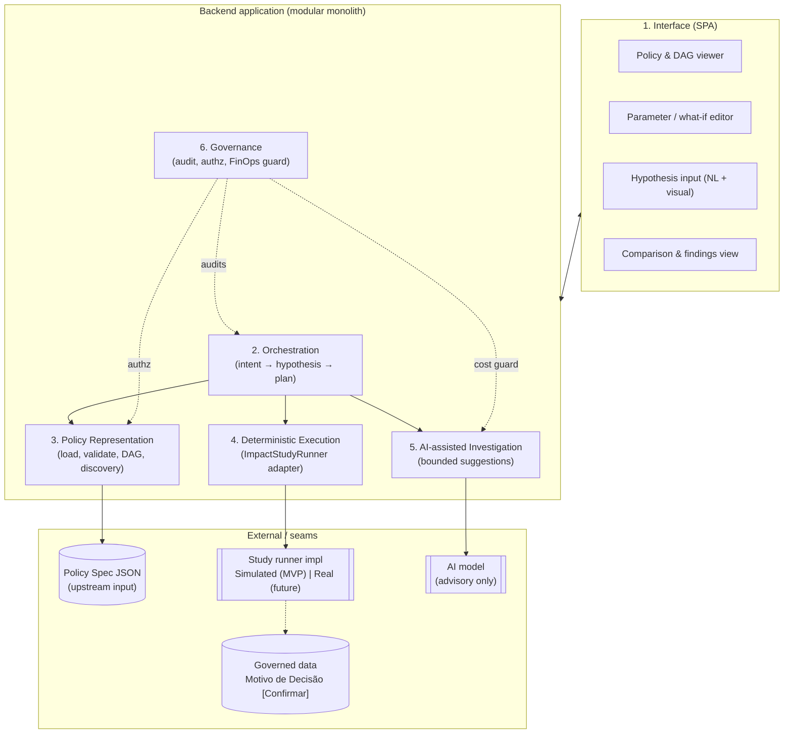

**Responsibilities:**

1. **Interface** — policy/rule/DAG visualization, parameter editing with preview and baseline/scenario diff, hypothesis entry (visual + NL), results and findings presentation with explicit evidence-level badges (none / SIMULADO / study-validated). (R1, R2, R6, R7)
2. **Orchestration** — interpret intent, structure a hypothesis, select the rules/variables/stages needed (reverse discovery), build the scenario, hand it to execution, request AI suggestions. It *coordinates*; it never calculates. (R3, R5.3)
3. **Policy Representation** — load and validate the Policy Spec, build the in-memory model (rules, variables, parameters, DAG), derive `consumed_by`, deduplicate parameters, answer dependency queries. (R16, R1, R5.3/5.4)
4. **Deterministic Execution** — the `ImpactStudyRunner` adapter: given a scenario (baseline + overrides) and the affected sub-DAG, produce a deterministic result or an explicit "cannot calculate". MVP = `SimulatedRunner` (clearly labeled). (R5)
5. **AI-assisted Investigation** — produce a bounded set of candidate scenarios/findings, each born `evidenceLevel=none` and raised only by a deterministic run (never by the model). (R8, R7)
6. **Governance** — persisted, append-only investigation record and audit lake (see §12 audit-guarantee note), authorization boundary, FinOps/session caps, privacy minimization at the model boundary. (R14, R15, NFR FinOps)

---

## 5. Fluxo ponta a ponta de uma hipótese

Worked example from the fixture: **"Testar renda mínima de R$ 2.500 → R$ 3.000"** → parameter **P001 (`renda_minima`)**, used by rule **R005 (`Validar renda mínima`)**.

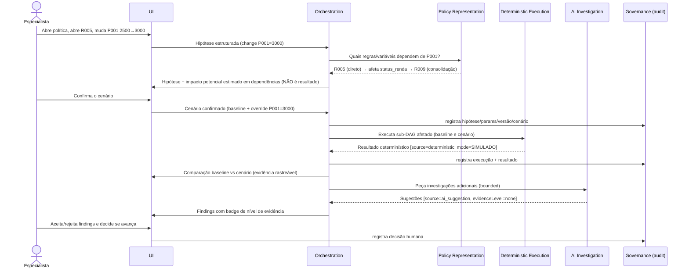

Key invariants in this flow:
- Dependency discovery (R005 → status_renda → R009) comes from the Policy Spec DAG + `inputs/outputs`, not from the model (R5.3).
- The potential-impact hint shown before execution is explicitly **not** a calculated result (R5.1, R5.10).
- Every deterministic result in the MVP is tagged `mode=SIMULADO` (R5.8), because no real executor and no real `Motivo de Decisão` are connected to the fixture (fixture README).

---

## 6. Modelo de dados e contrato JSON

### 6.1 Policy Spec (input, from the fixture contract)

The design treats the fixture's nine sections as the **working contract**, each `[Confirmar: contrato real]` against the true credit-policy platform artifact. The Playground never changes this artifact (R16.3); everything the Playground adds lives in a separate extensions file (§6.1.1).

| Section | Role in design | Notes / known gaps |
|---------|----------------|--------------------|
| `policy` | Identity + version (`id`, `source_commit`, `extracted_at`, `mode`). | `source_commit` is the Git commit (team decision D-Q2) and, with the S3 object version, forms the **policy version** used in audit and in the idempotency key (R14, §9.4). |
| `stages` | Group rules and declare table I/O. | Maps rule → area for R1.2 via `rule.stage_id → stage_area` in the extensions file (§6.1.1). Provisional mapping (see below, OQ-18). |
| `rules` | Atomic logic units: `logic.type`, `inputs`, `outputs`, `depends_on`, `parameters`, `motivo_*`. | `consumed_by` absent → derive by inverting `inputs`/`outputs`. |
| `variables` | Typed vars with `produced_by`, `category` (input/derived/output), `payload_path`. | `produced_by: external` (e.g. `perfil`, V010) = external input. |
| `parameters` | Editable thresholds (`value`, `unit`, `used_by`). | What-if targets. Editing limits come from `parameter_domains` in the extensions file (§6.1.1). Dedup vs. auto-extracted params. |
| `dag` | `tables` + `execution_order` (list of parallel layers). | Canonical execution order; validate acyclic + consistent with `depends_on`. |
| `motivos` | Decision reason codes bound to rules. | Explains *why* a case is reproved; shown in evidence. |
| `validation_map` | Maps internal var → athena/script/dmp keys + tolerance. | For real-executor validation `[Confirmar]`; unused by SimulatedRunner. |
| `output_vars` | Final output columns + cast. | Defines the comparable result surface. |

**Stage → policy area mapping (R1.2, OQ-18).** R1.2 names four policy areas (Extraction, ETL, Hard filters, Final base), while the fixture stages are named Extração, Elegibilidade, Oferta and Consolidação. The extensions file (§6.1.1) therefore declares an explicit, provisional `stage_area` mapping, without touching the Policy Spec:

| Fixture stage | `stage_area` | Rules |
|---------------|------------|-------|
| 01 Extração | Extraction | R001–R003 |
| 02 Elegibilidade | Hard filters | R004–R006 |
| 03 Oferta | Final base | R007–R008 |
| 04 Consolidação | Final base | R009 |

The fixture has no dedicated ETL stage (transformations are embedded in extraction casts). Validation (§7.1) treats a stage with no entry in `stage_area`, or with an unknown value, as a non-blocking warning: the viewer shows "área da política não informada" instead of guessing. The real mapping is confirmed against the real contract under OQ-18 / C5.

### 6.1.1 Playground extensions (complementary file, 1.2)

The Policy Spec is an upstream artifact that the Playground consumes and must not alter (R16.3). Metadata that belongs to the Playground is kept in **`fixtures/policy-playground-demo-extensions.json`**, which references the Policy Spec by id and never repeats or overrides its content.

| Section | Content | Used by |
|---------|---------|---------|
| `extends` | `file`, `policy_id`, `source_commit` of the Policy Spec it complements | Validation: must match the loaded Policy Spec |
| `extension_version` | Version of the extensions contract | Loader |
| `policy_source` | `vcs`, `repository`, `path`, `commit` (= `source_commit`) | Provenance shown in the viewer and in audit (team decision D-Q2) |
| `stage_area` | Stage id → policy area | R1.2, OQ-18 |
| `parameter_domains` | Parameter id → `editable`, `type`, `min`, `max`, `step` | Visual editor limits (R2.4, R4) |
| `datasets` | `dataset_version`, `kind`, `contains_pii`, `file`, `record_count` | `SimulatedRunner` input; `dataset_version` enters the idempotency key (§9.4, team decision D-Q6) |

The synthetic records themselves are in **`fixtures/policy-playground-demo-dataset.json`**. Keeping the three files separate lets each evolve on its own cycle: a new Policy Spec commit does not require new extensions, and the same commit can run against several dataset versions. If the extensions file is missing, the Policy Spec still loads and can be explored; parameters are then read-only, policy areas show as "não informada" and simulated execution is unavailable.

### 6.2 Internal model (derived, in-memory)

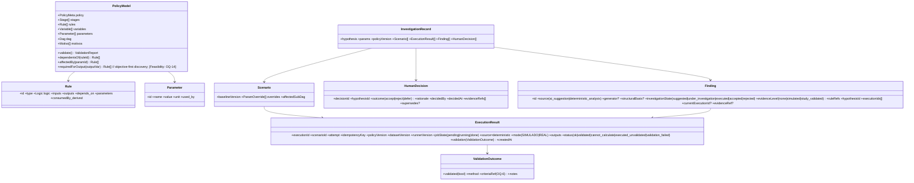

- **`consumed_by` derivation:** for each variable, `consumed_by = { rule.id | variable ∈ rule.inputs }`. For the fixture, `renda_mensal` (V001) → consumed by R005, R007.
- **Parameter dedup:** key parameters by `(name, scope)`; if an auto-extracted parameter collides with a predefined one (same name/used_by), keep the predefined definition and drop the duplicate, recording the merge in the validation report.
- **Append-only executions (no evidence overwrite).** A `Finding` references executions by a **list** `executionIds[]` plus a `currentExecutionId` pointer; each run appends a **new** `ExecutionResult` (incrementing `attempt`) and never mutates a prior one. A re-run therefore preserves the full evidence history; `currentExecutionId` moves to the newest run, but earlier results remain readable. This is what makes the §12 "append-only" guarantee hold at the data-model level.
- **Execution ≠ validation.** `ExecutionResult.status` separates "ran" from "validated": `ok` (ran, no validation step applicable — e.g. a `SimulatedRunner` run), `validated` (a real run that passed the validation step), `cannot_calculate` (did not complete), `executed_unvalidated` (a real run whose validation step has not confirmed the result), and `validation_failed` (a real run that did not meet the validation criteria). The `ValidationOutcome` records whether validation passed, by which `method`, and against which criteria (see §9.3 and OQ-6). `evidenceLevel` is **derived** from `status`+`mode`, never set directly, by this canonical map: `mode=SIMULADO & status=ok → simulated`; `mode=REAL & status=validated → study_validated`; every other status (`cannot_calculate`, `executed_unvalidated`, `validation_failed`) → `none`. AI suggestions with no execution → `none`.

---

## 7. Estratégia de validação e interpretação das regras

### 7.1 Policy Spec validation (R16.2, error handling §13)

Validation runs at load, before any exploration, producing a structured `ValidationReport` (never a silent pass):

1. **Schema/shape** — required sections present; each rule has `id`, `logic.type`, `inputs`, `outputs`.
2. **Referential integrity** — every `depends_on`, `parameters`, `produced_by`, `motivo.rule_id`, `used_by` points to a declared id.
3. **DAG integrity** — build graph from `depends_on` + `dag.execution_order`; detect **cycles**, orphan rules, and mismatches between `execution_order` and `depends_on`.
4. **Type/logic** — every `logic.type` is one of the **known, supported** types; an unknown type is a hard, comprehensible error (not a guess).
5. **Dedup + derive** — deduplicate parameters; derive `consumed_by`.
6. **Extensions binding** — `extends.policy_id` and `extends.source_commit` match the loaded Policy Spec, and every stage id and parameter id in the extensions file exists in it (blocking for the extensions; the Policy Spec itself still loads).
7. **Parameter domains** — each parameter's baseline `value` lies inside its domain in `parameter_domains` (blocking); a parameter without a domain is shown as read-only.
8. **Datasets** — each referenced file exists, declares `contains_pii: false` and has `record_count` records. A failure here blocks execution but not exploration.

If any blocking check fails → inform the specialist with a specific message and **do not proceed** (R16.2, R1.3).

### 7.2 Rule interpretation (closed evaluator, D-6)

A typed evaluator interprets only the known logic types. The MVP does **not** execute arbitrary SQL-like strings or model-generated expressions.

| `logic.type` | Interpretation strategy | Fixture example |
|--------------|------------------------|-----------------|
| `json_extract` | Read `path` from the (synthetic) payload, apply `cast`. | R001 → `$.cliente.renda_mensal` → number |
| `case_when` | Ordered branch eval; comparison operators and references to vars/params from a **fixed, parsed grammar** — not free SQL. First true branch wins, else `else`. | R005 → `renda_mensal >= renda_minima` → `status_renda` |
| `matrix_lookup` | Resolve `row_key`/`col_key` values, index `matrix`. | R008 → (`faixa`,`perfil`) → `limite_sugerido` |

**`case_when` expression handling** is the sensitive part: the MVP parses the condition into a small, validated AST over `{var|param|literal} {comparator} {var|param|literal}` joined by `AND`/`OR` and comparisons `=,>=,<=,>,<`. Anything outside this grammar is a validation error, not a best-effort execution. The real credit-policy platform grammar may be richer → `[Confirmar: contrato real]`, OQ-15.

> **Note on R007 literals** (`renda_mensal >= 5000` / `>= 3000`): the fixture encodes some thresholds as literals inside the rule rather than parameters. The design surfaces these as **read-only derived thresholds** in the viewer and flags that only `parameters` (P001/P002) are editable in the MVP what-if (R2 OQ-5). Promoting literals to editable parameters is out of MVP scope.

---

## 8. Gestão de baseline, cenários e dependências

### 8.1 Baseline isolation (D-5, R5.9)

- The loaded `PolicyModel` is the **immutable baseline**.
- A `Scenario` is `baseline + overrides` (e.g. `{P001: 3000}`). Execution reads the baseline and applies overrides at eval time; the baseline object is never mutated.
- Both baseline and scenario are executed, so the comparison in §9 is apples-to-apples.

### 8.2 Reverse dependency discovery (R5.3, R5.4 — Design directive 4)

Given a changed parameter (or an objective naming an output), compute the **minimal affected sub-DAG**:

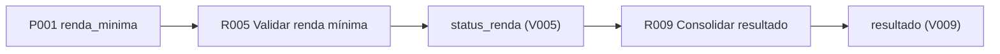

Algorithm (over the Policy Spec, no model involvement):
1. **Seed** = rules whose `parameters` contains the changed parameter (via `used_by`): P001 → R005.
2. **Forward closure** = follow `outputs → consumed_by` transitively: R005 → `status_renda` → R009.
3. **Required upstream** = `depends_on` closure of the seed, to execute correctly: R005 depends_on R001 (`renda_mensal`).
4. **Execution set** = upstream ∪ seed ∪ forward closure, ordered by `dag.execution_order`.

For the example: execute `R001` (layer 1), `R005` (layer 2), `R009` (layer 5) — skipping R002/R003/R004/R006/R007/R008 where they are not required by the affected outputs, **unless** the comparison target needs them (if comparing `resultado`, R009's other inputs — status_idade, status_comprometimento, limite_sugerido — must be present; the design computes them from baseline since their parameters are unchanged). This "changed-path recompute, reuse baseline elsewhere" rule is the core of making impact analysis generic and cheap.

**Objective-first discovery** (NL "qual o impacto na aprovação?") maps the objective to an output var (`resultado`) and runs the same closure backward from that output. This is exposed on the model as `PolicyModel.requiredForOutput(outputVar)` (the `depends_on`/`inputs` closure of the rule that produces the output), so the algorithm and the §6.2 interface agree. For the fixture it is tractable; for richer real grammars it remains `[Feasibility: Design]`, bound to OQ-14 — if it proves infeasible, the fallback is assisted manual selection of the relevant rules.

---

## 9. Integração com os estudos determinísticos

### 9.1 The generic capability (Design directive 3, R5.2)

Impact analysis is modeled as one interface, independent of the current `analise de impacto de estudos` file:

```
interface ImpactStudyRunner {
  runScenario(policyVersion, scenario, affectedSubDag) -> ExecutionResult
  // ExecutionResult = { source: "deterministic", mode: "SIMULADO"|"REAL",
  //                     outputs: {var: value}, status: "ok"|"cannot_calculate", diagnostics }
}
```

- `analise de impacto de estudos` is a **functional reference** for *what* the capability must do (compare produced final base vs. `Motivo de Decisão`), not an integration target (R5.2).
- Two implementations behind the same seam:
  - **`SimulatedRunner` (MVP):** executes the closed evaluator over the sub-DAG against a **synthetic payload set**, tags every result `mode=SIMULADO`. It performs no real historical comparison — the fixture has no history (fixture README). It exists to validate the *flow and contract*, never to assert real impact.
  - **`RealStudyRunner` (future, `[Confirmar: contrato real]`):** the preferred real path (R5.5); drives real studies and compares the final base against `Motivo de Decisão` using `validation_map`/`output_vars`.
- The orchestrator picks the runner by configuration; **the UI always shows the result's `mode`** so a simulated number is never presented as real (R5.8).

### 9.2 Deterministic tail: code / tests / PR (Design directive 5, R11, R12)

This is the demonstrative end-to-end tail and is **feasibility-gated, not assumed**:

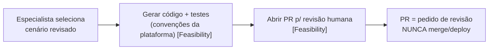

- Only a human-selected, human-reviewed scenario can enter codegen (R10.3, R11.2).
- The design **does not assume** the existing credit-policy platform documentation-generation skill produces functional code; functional codegen is a distinct capability to validate (R11.4).
- **MVP demonstration vs. real credit-policy platform integration (explicit boundary):**

  | Capability | MVP (demonstrated, no credit-policy platform access) | Future evolution (real credit-policy platform) |
  |------------|-----------------------------------|------------------------------|
  | Code + tests generation | Produce a **reviewable change artifact (diff + tests) against the fixture's conventions**, clearly labeled as a demonstration, not submitted anywhere. | Generate code/tests that truly follow real credit-policy platform repo structure, validated against the actual repo. |
  | Pull request | Show the PR *intent* and the traceable package (scenario → evidence → selection → diff); **no real PR is opened** when credit-policy platform repos/mechanics are unreachable. | Open a real PR against the appropriate credit-policy platform repository for human review. |
  | Credit-policy platform skills reuse | Not available (no credit-policy platform access in this environment). | Reuse the specialized credit-policy platform skills where applicable. |

- **Requirement-coverage flag (not a silent change):** R11.1 and R12.1 state functional platform-consistent code and a *real* PR as intended end-to-end outcomes. In an environment with **no credit-policy platform access** (the current case), the MVP can only demonstrate the artifact-and-intent form above; opening a real PR and proving real credit-policy platform consistency are **blocked on OQ-9 / risk R-6** and are not delivered by the proposed MVP scope. The requirements are preserved as-is; this gap is surfaced in the chat summary and in §15 for human decision — not removed or redefined here.
- PR creation (in the future form) is a request for review only, traceable back to scenario/evidence/selection, and never a merge/deploy (R12.2, R12.4, R14.3).

### 9.3 Execução real vs. validação bem-sucedida

Running a real study and *validating* its result are **two distinct steps**. The design must not treat "it ran" as "it is proven".

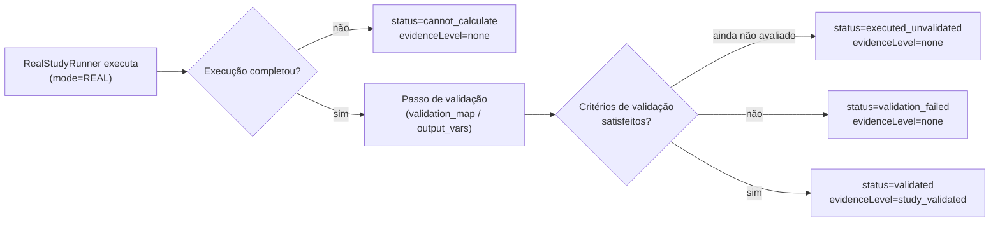

- **`study_validated` requires `mode=REAL` AND a passing validation step.** The validation step compares the produced final base against `Motivo de Decisão` through `validation_map`/`output_vars`. Only when it passes does `ValidationOutcome.validated = true` and the orchestrator derive `evidenceLevel=study_validated`.
- **Real-but-not-validated is representable:** `executed_unvalidated` (validation not yet confirmed) and `validation_failed` (did not meet criteria) are first-class `status` values; both keep `evidenceLevel=none` and are surfaced as such — never shown as proven impact.
- **Simulated path is unchanged:** a `SimulatedRunner` run has no real-history validation step and is `status=ok` with `evidenceLevel=simulated` and `mode=SIMULADO`; it can never become `study_validated`.
- **Quantitative criteria are pending, not invented.** The fixture's `validation_map` carries a `tolerance` field, but the **actual** validation thresholds/method for the real executor are not decided here and are bound to **OQ-6** (exact evidence-level definition) and the real contract (OQ-2/OQ-15). The design fixes the *shape* (there is a validation step with a recorded outcome), not the numbers.

---

### 9.4 Execução assíncrona, idempotente e reproduzível (D-12)

Every deterministic execution, simulated or real, follows the same job contract, so scaling and integrity do not depend on which runner is configured.

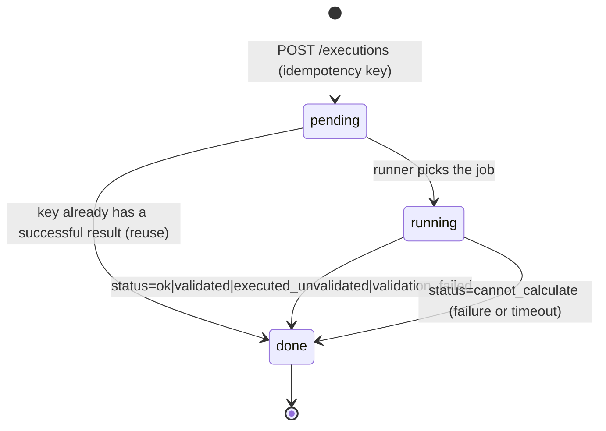

- **Idempotency key** = `sha256(policyVersion, sorted(overrides), datasetVersion, runnerVersion)`. `policyVersion` is the Policy Spec `source_commit` (Git commit, team decision D-Q2) plus the object version in S3; `datasetVersion` identifies the anonymized/synthetic snapshot (D-Q6).
- **Reuse.** If a successful `ExecutionResult` with the same key exists, the job returns it immediately (`attempt` is not incremented and no new compute runs). This makes retries safe (NFR Reliability 3) and saves cost (NFR FinOps 3).
- **Reproducibility (R14.6).** Re-running a recorded key against the recorded versions must produce the same `outputs`; a mismatch is surfaced as an integrity error and never silently replaces the original result.
- **Where it runs.** `SimulatedRunner` jobs are light and run inside the API task. `RealStudyRunner` jobs (C1) run as separate ECS tasks started on demand from the same image (team answer D-Q1: on-demand SQL/Python jobs), so a long study never blocks the API.
- **How the interface follows it.** `GET /executions/{id}` returns `jobState` and, when done, the result; the interface polls every few seconds (team decision D-DQ4). No WebSocket infrastructure is needed for the MVP.
- **Timeout.** Each runner has a configurable maximum duration; exceeding it ends the job with `status=cannot_calculate` and no partial number (R5.7).

---

## 10. Arquitetura da investigação assistida por IA

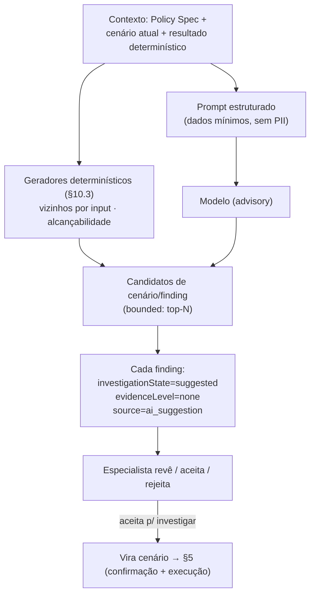

### 10.1 Ciclo de vida de um `Finding` — máquina de estados

`investigationState` (processo) e `evidenceLevel` (evidência) são **eixos ortogonais**. O diagrama abaixo cobre rejeição antes da execução, execução, aceitação, rejeição após execução e reexecução.

```mermaid
stateDiagram-v2
    [*] --> suggested
    suggested --> rejected: especialista descarta (sem executar)
    suggested --> under_investigation: aceita p/ investigar
    under_investigation --> rejected: descarta antes de executar
    under_investigation --> executed: execução determinística (append ExecutionResult)
    executed --> accepted: decisão humana
    executed --> rejected: decisão humana após ver evidência
    executed --> under_investigation: re-run (novo cenário/params) → nova execução
    accepted --> under_investigation: re-run após aceitar (reabre; append nova execução)
    rejected --> [*]
    accepted --> [*]
```

**Regras de transição e preservação de histórico:**

- **Rejeição antes da execução.** `suggested → rejected` e `under_investigation → rejected` são válidas; o finding fica `evidenceLevel=none` e nenhuma execução é criada (R8.4, R10).
- **Execução.** `under_investigation → executed` **append** um novo `ExecutionResult` ao `executionIds[]` do finding e move `currentExecutionId`; nunca sobrescreve execuções anteriores.
- **Reexecução.** Ajustar cenário/parâmetros e rodar de novo volta a `under_investigation` e produz **outro** `ExecutionResult` (`attempt` incrementado). Os resultados anteriores permanecem no `InvestigationRecord` e continuam auditáveis (R14, §12).
- **Associação evidência ↔ execução.** O `evidenceLevel` **exibido** é o da execução apontada por `currentExecutionId` (a mais recente); cada execução histórica mantém o seu próprio nível. A UI deixa claro qual execução sustenta o número mostrado, e execuções anteriores de nível diferente não são apagadas (apenas deixam de ser a "corrente").
- **Aceitação/rejeição após execução.** `executed → accepted|rejected` muda apenas o estado de processo; **não** altera o `evidenceLevel` de nenhuma execução (§11).

### 10.2 Invariantes da investigação assistida por IA

- **Bounded by design (R8.2):** the investigation module returns at most *N* suggestions per request (N a configurable session cap, default small), ranked; no unbounded stream. No autonomous red-team loop (R8 scope note). Deterministic candidates (§10.3) and model suggestions share the same cap and the same ranking.
- **Two orthogonal axes, never collapsed into one "proven" flag:**
  - **`investigationState`** — process state per §10.1.
  - **`evidenceLevel`** — how strong the backing is: `none` (AI suggestion only), `simulated` (a `SimulatedRunner` result over synthetic data), or `study_validated` (a real `RealStudyRunner` result **that also passed validation** — see §9.3). This is an *evidence* fact, derived only from a deterministic execution's `status`+`mode`.
- **A finding being `executed`/`accepted` does NOT make it real evidence.** A `SimulatedRunner` run advances `investigationState` to `executed` and sets `evidenceLevel=simulated` only — it can never set `study_validated` (R5.8, fixture README). A real run only reaches `study_validated` after validation passes (§9.3); a real run that merely completed is `executed_unvalidated`, still **not** `study_validated`.
- **AI never sets evidence (R5.10, R7):** `source=ai_suggestion` findings are born `evidenceLevel=none`; the orchestrator derives `evidenceLevel` only from a deterministic `ExecutionResult`, never from model text. No `ai_suggestion` object ever carries a numeric impact.
- **Cannot-answer (R7.3):** if no runner/study can evaluate a suggested scenario, the finding keeps `evidenceLevel=none` and the UI states the limitation explicitly.
- **Finding → scenario (R9):** accepting a finding for investigation creates a scenario that goes through the **same** confirmation + execution + evidence path (R9.2); whether execution starts automatically or on explicit action is OQ-8 (design default: explicit action, to keep human control and bound cost).

### 10.3 Geradores determinísticos de candidatos e ranking com feedback (R8.5, R8.6, D-10)

The reverse discovery of §8.2 deliberately recomputes only the changed path. That is right for calculating impact, but it means discovery never looks at rules outside that path, and those are exactly the places where "what nobody asked" lives. Two deterministic generators run over the validated Policy Spec whenever a scenario changes a parameter. They do not call the model and do not produce impact numbers.

**G1 — Shared-input neighbours.** Let *C* be the rules in the changed path (§8.2). A rule *R* ∉ *C* is a candidate when `R.inputs ∩ inputs(C)` contains a non-parameter variable. Its forward closure (`outputs → consumed_by`) is attached as context.

**G2 — Branch reachability under the target outcome.** For `case_when` rules whose branches compare a single numeric variable with literals or parameters (the closed grammar of §7.2), compute the interval of that variable selected by each branch, with first-match semantics (branch *i* = `cond_i ∧ ¬cond_<i`). Intersect each interval with the constraint the target outcome imposes on the same variable (e.g. approval in R009 requires `status_renda = 'ELEGIVEL'`, i.e. `renda_mensal ≥ renda_minima`). A branch whose intersection is empty in the scenario but not in the baseline is **newly unreachable**; the reverse is **newly reachable**. The result is propagated to `matrix_lookup` rows keyed by that branch's output. Conditions outside the analyzable grammar are skipped and reported as "não analisável", never guessed.

**Worked example on the fixture (P001: 2500 → 3000).**

| Step | Baseline (`renda_minima = 2500`) | Scenario (`renda_minima = 3000`) |
|------|----------------------------------|----------------------------------|
| G1 | R007 reads `renda_mensal`, like R005 → candidate; R008 attached via `faixa` | same |
| Approval constraint | `renda_mensal ≥ 2500` | `renda_mensal ≥ 3000` |
| R007 `BASICA` (`renda_mensal < 3000`) ∩ approval | `[2500, 3000)` — reachable | empty — **newly unreachable** |
| R008 rows | `BASICA` used by approved proposals | `BASICA` row (A, B) never used by approved proposals |

The candidate finding reads: *"Com renda mínima 3.000, nenhuma proposta aprovada cai na faixa BASICA de R007; a linha BASICA da matriz de oferta de R008 deixa de ser usada para aprovados."* All values quoted come from the Policy Spec itself (thresholds and matrix entries), so this is a structural fact about the policy, not an impact estimate.

**Evidence status.** A generator candidate is born `source=deterministic_analysis`, `evidenceLevel=none`, with `structuralBasis` recording the intervals and rules involved. It follows the same lifecycle as any finding (§10.1): to obtain evidence, the specialist turns it into a scenario and runs it (§5). For the example, a `SimulatedRunner` run over payloads with `renda_mensal ∈ [2500, 3000)` makes the shift visible with `evidenceLevel=simulated`.

**Ranking with feedback (R8.6).** Each candidate is ranked by:

```
score = w_struct · [source = deterministic_analysis]
      + w_fb     · relevance(policy, kind)
relevance(policy, kind) = (relevant + 1) / (assessed + 2)
```

where `kind` is the generator (`G1`, `G2`) or `ai_suggestion`, and the counts come from the assessments recorded under R8.4 for that policy. The `+1/+2` smoothing makes an unassessed kind start at 0.5. Weights are configuration (defaults `w_struct = 0.6`, `w_fb = 0.4`, tunable under OQ-7). The cap *N* of §10.2 is applied after ranking.

---

## 11. Evidências, findings e decisão humana

- **Evidence model:** an `ExecutionResult` is the only evidence. A `Finding` references `{hypothesisId, ruleRefs, executionId?, evidenceRef?}` and carries the two axes from §10 (`investigationState`, `evidenceLevel`). A finding may display a number **only** when it has an `executionId` + `evidenceRef`; a finding at `evidenceLevel=none` must never display any number as if calculated (R7.2, R7.4).
- **UI distinction — simulated vs. study-validated (R5.8, R7.4):** the interface renders `evidenceLevel` explicitly and distinctly:
  - `none` → "Hipótese sem comprovação" (no number shown). This also covers a real run that is `executed_unvalidated` or `validation_failed` — the UI states "executado, mas não validado" / "falhou na validação" and shows no proven number.
  - `simulated` → "Resultado SIMULADO (dados sintéticos — não é impacto real)", visually marked (e.g. a persistent SIMULADO badge next to every number).
  - `study_validated` → "Validado por estudo determinístico (`Motivo de Decisão`)".
  The badge is derived from the current execution's `status`+`mode` (§9.3), so a simulated number can never be shown without the SIMULADO marking, and a real-but-unvalidated run is never shown as proven. The MVP, running on the fixture, can only reach `simulated`.
- **Comparison surface (R6):** baseline vs. scenario over `output_vars` (fixture: `resultado`, `limite_sugerido`), plus the affected `motivos`. Shown with the related rules and data context used, and carrying the same `evidenceLevel` badge (R6.2). If baseline results are unavailable, the UI says comparison cannot be shown (R6.4).
- **Human decision (R10):** specialist accepts/rejects each finding (sets `investigationState`) and decides whether the change is promising. Accepting a finding changes only its process state, never its `evidenceLevel`. Only an explicit selection enables the deterministic tail (R10.2/10.3). Accepting a finding is never read as approval to change production (R10.4).
- **Decision record (R10.5–10.6):** the hypothesis-level decision is a `HumanDecision` with outcome `accept`, `reject` or `defer`, a mandatory rationale, the specialist's identity, the timestamp and the evidence references. It is never edited: a change of mind creates a new `HumanDecision` whose `supersedes` points to the previous one, and the interface shows the latest while keeping the chain visible. `defer` keeps the hypothesis open for more investigation without advancing it.
- **Traceability (R14):** every step appends to the `InvestigationRecord`; a finding links back to rule, hypothesis, execution, and evidence (with its `evidenceLevel`); an advanced change links back to evidence + human selection.

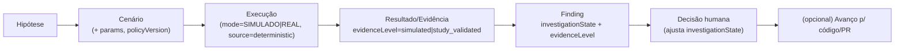

---

## 12. Segurança, privacidade, auditoria e FinOps

| Concern | Design posture | Requisito |
|---------|----------------|-----------|
| Governed data access | All credit-data access goes through an **authorization boundary**; no ungoverned copies. MVP uses a simplified role set; reuse of real governance is preferred `[Confirmar]`. | R15.1, R15.3, D-8 |
| Model privacy | The AI prompt is built from the Policy Spec + scenario structure; **PII minimized** — synthetic payloads for the fixture, and no raw `Motivo de Decisão` rows sent to the model. | R15.2 |
| Instruction/execution separation | The model never executes rules and never writes a result; rule evaluation is the closed evaluator only (D-4, D-6). | R5.10, R7 |
| No autonomous production change | No code path merges/deploys; PR is review-only. | R10.4, R12.2 |
| No impact without evidence | Impact numbers only from the deterministic runner; AI output separately labeled. | R5.1, R7 |
| Auditability | `InvestigationRecord` capturing hypothesis, params, policy version, execution, result, and decision, written **append-only** and persisted in DynamoDB; every event is also written to the S3 audit lake. See the audit-guarantee note below for exactly what is and is not guaranteed. | R14 |
| FinOps | Per-session cap on AI investigations (bounded suggestions §10) + per-hypothesis cost: model tokens reported by each Bedrock response, summed per hypothesis and recorded in the `InvestigationRecord` (§16). Concrete numbers OQ-7. | NFR FinOps, R8 |
| Product metrics | The `InvestigationRecord` stores `hypothesis.submittedAt` and the first `ExecutionResult.createdAt` per hypothesis; their difference is the in-app hypothesis-to-evidence time. The relevant-finding share is `relevant / assessed` per session. Both are emitted as application metrics (§16). This is a proxy; the end-to-end business lead time stays under OQ-13. | Primary-objective NFR 2–3 |

### Audit guarantee — what "append-only" means in the MVP

The levels are deliberately distinguished, so that each guarantee is stated only as strongly as the design actually provides it:

| Level | What it means | MVP status (1.2) |
|-------|---------------|------------------|
| **Append-only history** | The application records each step as a new entry and never edits a prior one. | **Committed.** |
| **Persistence across sessions** | The investigation history survives restarts and can be resumed or reviewed later. | **Committed** — `InvestigationRecord` in Amazon DynamoDB (team decision D-Q8; resolves OQ-16). |
| **Append-only audit lake** | Every event is also written as a JSON/Parquet object to S3; the application role has no update or delete permission on that bucket; the lake is queryable with Amazon Athena. | **Committed** — team decision D-Q9 (resolves OQ-10). |
| **Storage-enforced immutability** | Write-once enforcement at storage level (S3 Object Lock). | **Optional.** Enabled per environment if governance requires it; the design does not depend on it. |

Events are written to DynamoDB first; the audit writer then emits the event to S3 with the same `eventId`, so a retry produces the same object key instead of a duplicate. Audit write failures are retried and alarmed, never silently dropped.

---

## 13. Tratamento de erros e falhas

Comprehensible, specific errors (fixture README requires this); never a silent fallback to a fabricated value.

| Failure | Behavior | Requisito |
|---------|----------|-----------|
| Policy Spec missing/unreadable/invalid schema | Block load; show which section/field failed; do not explore. | R16.2, R1.3 |
| Broken reference / unknown `logic.type` / cycle in DAG | Validation error naming the rule/edge; do not execute. | §7.1, R16.2 |
| Deterministic execution fails/incomplete | `status=cannot_calculate`; report "impact could not be calculated"; **no** estimated/AI value substituted. | R5.7 |
| Real run completed but not validated | `status=executed_unvalidated`; show "executado, mas não validado"; `evidenceLevel=none`; never shown as proven (§9.3). | R5.1, R7.2 |
| Real run failed validation criteria | `status=validation_failed`; show "falhou na validação do estudo"; `evidenceLevel=none`. | R5.1, R7.2 |
| Real executor unavailable | Use `SimulatedRunner` **only if** result is labeled `SIMULADO`; otherwise state execution unavailable. | R5.8, NFR reliability |
| No deterministic execution can answer the question | Finding stays `evidenceLevel=none`; UI states the limitation. | R7.3 |
| AI returns malformed/over-limit suggestions | Drop to the bounded set; discard malformed; never block the deterministic result. | R8.2 |
| Unauthorized policy/dataset | Not exposed; access-denied message. | R15.3 |

---

## 14. Estratégia de testes e critérios de validação do design

(Design-level strategy; no test code written in this phase.)

- **Policy Spec validation tests** — valid fixture passes; mutated fixtures (missing field, dangling `depends_on`, injected cycle, unknown `logic.type`, duplicate parameter) each produce the right blocking error; an extensions file that does not match the Policy Spec is rejected while the Policy Spec still loads; a stage without an entry in `stage_area` produces a non-blocking warning; the Policy Spec file is byte-identical before and after any session.
- **Generator tests (§10.3)** — for P001 = 3000 on the fixture, G1 returns R007 (with R008 attached) and G2 reports R007 `BASICA` as newly unreachable under approval, with R008 row `BASICA` attached; for P001 = 2500 (baseline) G2 reports nothing new; an out-of-grammar condition is reported as "não analisável"; no generator output carries an impact number or an `evidenceLevel` above `none`.
- **Ranking tests** — with no assessments every kind scores 0.5 on the feedback term; after assessments the ordering follows the smoothed relevance; the cap *N* is applied after ranking.
- **Metrics tests** — a hypothesis that reaches a deterministic result records both timestamps; one that ends in `cannot_calculate` records no evidence timestamp; the relevant-finding share counts only assessed findings.
- **Evaluator tests** — `json_extract`/`case_when`/`matrix_lookup` over known synthetic inputs produce deterministic outputs; out-of-grammar `case_when` is rejected.
- **Dependency discovery tests** — changing P001 yields exactly {R001→R005→R009} as the affected/required set in valid DAG order; unrelated rules are not recomputed.
- **Baseline isolation tests** — after a scenario run, the baseline model is byte-identical.
- **State-machine tests** — the §10.1 transitions hold: `suggested → rejected` and `under_investigation → rejected` are allowed without any execution; `executed → accepted|rejected`; a re-run returns to `under_investigation` and appends a new `ExecutionResult` without mutating prior ones.
- **State/evidence separation tests** — `investigationState` and `evidenceLevel` move independently: accepting a finding changes state but not evidence; no `source=ai_suggestion` finding carries a numeric impact or any `evidenceLevel` above `none` without a deterministic `ExecutionResult`.
- **Execution-vs-validation tests** — a `SimulatedRunner` run reaches `evidenceLevel=simulated` and **never** `study_validated`; a real run with `status=executed_unvalidated` or `validation_failed` stays `evidenceLevel=none`; `study_validated` is reached only when `mode=REAL` AND `ValidationOutcome.validated=true` (§9.3).
- **Evidence-history tests** — after a re-run, prior `ExecutionResult`s remain in the `InvestigationRecord`; `currentExecutionId` points to the newest; the displayed `evidenceLevel` matches the current execution, and historical executions keep their own level.
- **Simulated-labeling tests** — every number derived from a current execution with `mode=SIMULADO` renders with the SIMULADO marking; no code path shows a simulated number without it.
- **Impact-source tests** — all impact numbers come from a deterministic `ExecutionResult` (`source=deterministic`) with a `mode`; AI output is stored separately.
- **Traceability tests** — a finding resolves to its rule, hypothesis, execution(s), evidence (and the current `evidenceLevel`); an advanced change resolves to evidence + human selection.
- **Audit-level tests** — records are only appended, never rewritten; a session reloaded from DynamoDB reproduces the same chain; every event has exactly one audit object in S3 (retries do not duplicate); the application role cannot update or delete audit objects.
- **Idempotency and reproducibility tests (§9.4)** — the same execution request twice returns the same `executionId` and runs compute once; a recorded key re-run against the recorded versions yields identical `outputs`; a forced mismatch is reported as an integrity error.
- **Decision tests (R10.5–10.6)** — every outcome requires a rationale; a second decision on the same hypothesis creates a new record with `supersedes` and leaves the first unchanged; `defer` does not enable the deterministic tail.
- **Scalability tests** — with two API tasks behind the load balancer, a session started on one task continues on the other; 50 concurrent simulated sessions complete without errors; a long runner job does not raise API latency for other sessions.
- **Degradation tests** — with the model endpoint unavailable, exploration, visual editing, execution and decisions still work and the interface states that AI features are unavailable.
### 14.1 Matriz de cobertura dos requisitos

Three distinct columns: **Addressed** = the design has an architectural answer; **Delivered in MVP** = the MVP, running on the synthetic fixture with no credit-policy platform access, actually exercises it; **Depends on OQ/feasibility** = blocked or partial until a decision/validation. "Delivered in MVP" is **not** claimed for anything that is only architecturally foreseen.

| Req | Addressed | Delivered in MVP | Depends on OQ/feasibility |
|-----|:---------:|:----------------:|---------------------------|
| R1 Policy exploration | ✓ | ✓ (over fixture) | OQ-1 (which real policy) |
| R2 Two entry points / hybrid | ✓ | ✓ | OQ-5 (visual-edit depth) |
| R3 Hypothesis structuring | ✓ | ✓ | OQ-3 |
| R4 Human confirmation | ✓ | ✓ | — |
| R5 Deterministic impact | ✓ | ◑ **SIMULADO only** | OQ-4 (real executor); real path §9.3 |
| R6 Baseline vs scenario | ✓ | ✓ (simulated numbers) | tied to R5 |
| R7 Evidence / proven-unproven | ✓ | ✓ | OQ-6 (exact evidence-level + validation criteria) |
| R8 AI discovery (bounded) | ✓ | ✓ (incl. deterministic generators G1/G2 and feedback ranking, §10.3; default cap 10) | weights tunable |
| R9 Finding → scenario | ✓ | ✓ | OQ-8 (auto vs manual) |
| R10 Human decision | ✓ | ✓ (Accept/Reject/Defer, immutable, superseded) | — |
| R11 Code+tests (credit-policy platform conventions) | ✓ | ◑ **demo artifact only** | OQ-9 / R-6 (real credit-policy platform) |
| R12 Pull request | ✓ | ◑ **PR intent only, no real PR** | OQ-9 / R-6 |
| R13 Domain-context freshness | ✓ | ◑ staleness surfaced; auto-regen not guaranteed | OQ-2 |
| R14 Traceability/audit | ✓ | ✓ persisted (DynamoDB) + append-only audit lake (S3) + reproducible executions | Object Lock optional |
| R15 Governed data / privacy | ✓ | ◑ federation path designed; demo uses simplified groups; synthetic data only | real Azure AD connection depends on corporate approval |
| R16 Consume+validate Policy Spec | ✓ | ✓ (fixture validated) | OQ-2/OQ-15 (real schema) |
| NFR lead-time | ✓ (objective) | ◑ in-app hypothesis-to-evidence time + relevant-finding share (§12) | OQ-13 (end-to-end measurement) |
| NFR usability (no code) | ✓ | ✓ | — |
| NFR performance | ✓ | ✓ polling status; 30 s P95 for structuring | study execution time has no target |
| NFR scalability | ✓ | ✓ stateless API on ≥ 2 Fargate tasks; runner tasks isolated | validated at 50 concurrent sessions |
| NFR FinOps | ✓ | ✓ session caps (default 10 findings) + result reuse by idempotency key | — |
| NFR reliability/integrity | ✓ | ✓ incl. model-outage degradation and idempotent retries | — |

Legend: ✓ fully, ◑ partial/with explicit limitation, n/a not exercised in MVP. No requirement is unaddressed. The ◑ rows are exactly the limitations stated in §9.2, §9.3, §12, §13 and §15 — this matrix consolidates them; it does not introduce new scope.

- **Design validation gate:** every requirement R1–R16 + NFRs maps to at least one section here (consolidated in §14.1). A requirement with no architectural answer is a design gap to resolve before Tasks; R11/R12's real-PR/real-credit-policy platform portion is flagged as such in §9.2, §14.1 and §15.

---

## 15. Decisões pendentes, riscos e dependências externas

### Open questions needing human/credit-policy platform decision (carried + new)

| Ref | Question | Impact if unresolved |
|-----|----------|----------------------|
| OQ-2 / OQ-15 | Real Policy Spec **owner, availability, freshness, and true schema** vs. the fixture. | §6/§7 contract may shift; validation rules may change. |
| OQ-4 | Can a **real deterministic executor** be connected for the demo, or is `SIMULADO` the only path? | Determines whether any shown number is real. |
| OQ-9 / R-6 | Are credit-policy platform **repos/skills/PR mechanics** reachable in the hackathon window? | §9.2 tail degrades to a non-submitted diff; **R11.1/R12.1 real-PR/real-platform outcome not delivered** without this (requirement-coverage gap, see §9.2). |
| OQ-16 *(resolved in 1.2)* | Cross-session persistence and store. | Resolved: DynamoDB for state, S3 audit lake (team decisions D-Q8, D-Q9; §12). |
| OQ-14 | Does **objective-first reverse discovery** hold for richer real grammars? | §8.2 may need an assisted-selection fallback. |
| OQ-5 | Which parameters are **visually editable** (params only, or literals too)? | §7 editor scope. |
| OQ-18 | Real mapping of Policy Spec stages to the four policy areas. | §6.1: the fixture mapping is provisional; the viewer may label areas incorrectly for a real policy until confirmed. |
| OQ-6 / OQ-8 / OQ-13 | exact evidence-level definition (what qualifies as `study_validated`, any intermediate level); auto vs. manual finding-run; end-to-end lead-time measurement. | Tunable; defaults proposed above. OQ-7, OQ-10, OQ-11 and OQ-12 were resolved in Requirements 1.2 from the team's answers. |

### Risks

- **R-1 Fixture ≠ real contract.** All §6/§7 decisions are `[Confirmar: contrato real]`; the design isolates the contract behind Policy Representation so a schema change is localized.
- **R-2 `case_when` grammar richness.** Real conditions may exceed the closed grammar; mitigation: validation rejects the unknown rather than guessing.
- **R-3 No real history for the fixture.** Nothing in the MVP demo is a real impact; mitigation: mandatory `SIMULADO` labeling.
- **R-6 Demonstrative tail feasibility.** Code/tests/PR against the credit-policy platform is unproven; mitigation: adapter seam + graceful degradation to a reviewable artifact.

### External dependencies

- Upstream producer of the Policy Spec JSON (not the Playground).
- A real study executor + governed `Motivo de Decisão` access (for `REAL` mode).
- Credit-policy platform repositories, conventions, and skills (for the deterministic tail).
- An AI model endpoint (advisory role only).

---

## 16. Visão de implantação AWS (MVP)

The logical architecture of §4 is unchanged; this section maps it to AWS services (D-9, D-11, D-12). The application is still **one codebase and one container image**: every module of §4 runs in the API service, and the same image is started as a runner task when a real study must run.

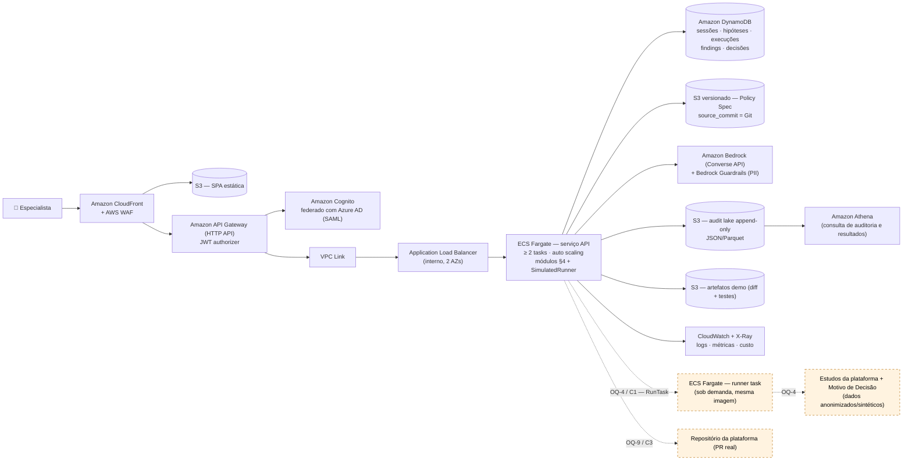

| Responsabilidade (§4) | Serviço AWS | Observação |
|-----------------------|-------------|------------|
| Interface (SPA) | Amazon S3 + Amazon CloudFront + AWS WAF | Uma SPA única; conteúdo estático. |
| Entrada da API | Amazon API Gateway (HTTP API) com JWT authorizer do Cognito, VPC Link e Application Load Balancer interno | Throttling por usuário na borda; a aplicação não fica exposta à internet. |
| Backend modular | Amazon ECS on AWS Fargate — um serviço, no mínimo 2 tasks em 2 AZs, auto scaling por CPU e requisições | Decisão do time D-Q7. Stateless (D-11): qualquer task atende qualquer sessão. |
| Execução determinística | `SimulatedRunner` dentro da task da API; `RealStudyRunner` (C1) como ECS task sob demanda (RunTask) | Contrato assíncrono e idempotente de §9.4; resposta D-Q1 (jobs SQL/Python sob demanda). |
| Estado da investigação | Amazon DynamoDB, on-demand | `InvestigationRecord`, execuções (chave de idempotência), findings, decisões, contadores de FinOps (D-Q8). |
| Auditoria | Amazon S3 append-only (JSON/Parquet) + Amazon Athena | O papel da aplicação não tem permissão de update/delete; Object Lock opcional (D-Q9, §12). |
| Policy Spec (entrada) | Amazon S3 com versionamento | `policy.source_commit` (commit Git, D-Q2) + versão do objeto = `policyVersion` usado na chave de idempotência. |
| Modelo (advisory) | Amazon Bedrock, Converse API | Único ponto de chamada ao modelo, atrás de um adaptador; a escolha do modelo é configuração (D-Q3). |
| Minimização de PII | Amazon Bedrock Guardrails (sensitive information filters) | Entrada e saída do modelo. Complementa a regra de não enviar linhas de `Motivo de Decisão` ao modelo (R15.2). |
| Identidade e papéis | Amazon Cognito federado com Azure AD via SAML; grupos Policy Specialist, Risk Approver, Data Analyst, Viewer | Decisão do time D-Q5. Na demo, os mesmos grupos com usuários de teste. |
| Segredos e criptografia | AWS Secrets Manager; AWS KMS em S3, DynamoDB e logs; TLS 1.2+ | — |
| Observabilidade | Amazon CloudWatch (logs estruturados, métricas customizadas, alarmes) + AWS X-Ray | Métricas de produto do §12, tokens por hipótese, latência P95 da estruturação. |
| FinOps | Tags de alocação de custo + AWS Budgets + contadores por sessão no DynamoDB | Reuso de resultados pela chave de idempotência (§9.4). |
| Infraestrutura como código | AWS CDK | Um stack por ambiente. |
| Execução real (C1) e PR real (C3) | Condicionais | Dependem de OQ-4 e OQ-9. |

### 16.1 Escalabilidade e caminho de evolução

| Dimensão | MVP (10–50 usuários, D-DQ3) | Se a demanda crescer |
|----------|-----------------------------|----------------------|
| Requisições da API | 2 tasks Fargate em 2 AZs; auto scaling horizontal | Mais tasks; nenhuma mudança de código, porque a API é stateless |
| Execuções determinísticas | Simuladas in-process; reais como RunTask isolada | Fila (Amazon SQS) entre a API e os runners, com concorrência controlada |
| Estado | DynamoDB on-demand | Sem mudança; particionamento por `sessionId` já distribui a carga |
| Reuso de resultados | Chave de idempotência no DynamoDB | Cache dedicado só se a latência de leitura virar gargalo medido |
| Chamadas ao modelo | Limites por sessão; Guardrails | Cotas por usuário e por equipe |
| Interface | Polling do status | Notificação por WebSocket, se o polling gerar carga relevante |

The right-hand column is an evolution path, not MVP scope: each item is adopted only when a metric from §12 shows the need.

---

## 17. Alternativas avaliadas e não adotadas

The team's inception exploration produced several architectural options. Those below were evaluated against the requirements and deliberately left out of the MVP; the reasons are recorded so the decision can be revisited with evidence.

| Alternativa | Por que não foi adotada |
|-------------|-------------------------|
| Microsserviços separados em Go (CRUD) e Python (agentes) | Duas linguagens e seis serviços para 10–50 usuários aumentam custo operacional sem ganho mensurável; D-1 mantém um monólito modular com as mesmas fronteiras. |
| Amazon ElastiCache (Redis) para resultados de estudos | A reutilização já é garantida pela chave de idempotência no DynamoDB (§9.4); um cache dedicado entra só se a latência medida exigir. |
| Amazon SQS entre agentes e serviço de findings | Com um único serviço não há fronteira assíncrona a desacoplar; SQS aparece no caminho de evolução das execuções (§16.1). |
| AWS Step Functions para orquestrar estudos | O ciclo de vida de §9.4 cabe em um job com estados no DynamoDB; Step Functions é útil se os estudos reais exigirem pipelines de várias etapas (C1). |
| Micro-frontends (shell + SPAs por domínio) | Uma única experiência é requisito de produto (R2.5); várias SPAs independentes não trazem benefício para uma equipe e um produto. |
| AWS CodeCommit + CodePipeline como origem das políticas | O Playground consome o Policy Spec já consolidado (R16.3), identificado pelo commit Git; não precisa hospedar o repositório. |
| Sessões compartilhadas somente leitura | Útil para aprovadores, mas fora do MVP; o modelo de dados (sessão persistida, papéis) já permite adicioná-las sem migração. |
| Banco sandbox sempre ligado com dados sintéticos | Os experimentos do MVP rodam sobre o fixture e snapshots sintéticos versionados (`datasetVersion`); um banco dedicado entra com o `RealStudyRunner` (C1). |
| Agentes gerenciados (Bedrock Agents) para o red team | Os candidatos principais vêm de geradores determinísticos (D-10); o modelo só ordena e redige, o que uma chamada Converse resolve com menos superfície. |

---

## Approval Gate

This is the Design phase deliverable. Per the Kiro Specs workflow, Tasks will not begin until this document is explicitly approved. The requirement-coverage check and the list of questions needing human decision are provided in the chat response.

---

## Solution Overview — Mermaid

Faithful visual summary of the design already described in §4–§13. It adds nothing new. **Solid edges = MVP core flow on the synthetic fixture; dashed edges/components = conditional on an open question (OQ) and NOT available in the synthetic MVP.** The real study executor and real PR creation are shown as conditional, matching §9 and §15; persistence and the audit lake are part of the MVP since 1.2 (§12).

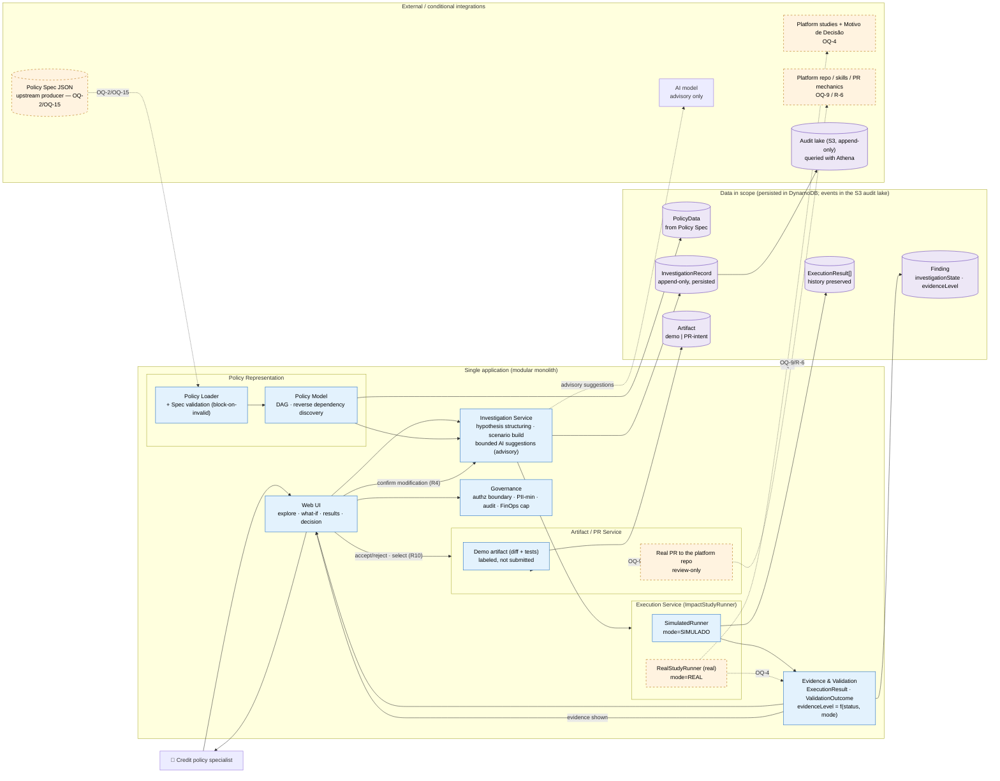

**Legend.**
- **Solid, blue (core):** runs in the synthetic MVP — UI, Policy Loader/validation, Policy Model + reverse discovery, Investigation Service, `SimulatedRunner`, Evidence & Validation, Governance, and the labeled demo artifact.
- **Dashed, amber (conditional):** depends on an open question and is **not** available in the synthetic MVP — `RealStudyRunner`/real studies (OQ-4), real PR + credit-policy platform repo/skills (OQ-9/R-6). The upstream Policy Spec producer is also upstream/conditional (OQ-2/OQ-15).
- **Purple (data):** entities persisted in DynamoDB, with every event also written to the append-only S3 audit lake (§12).
- **AI model** is advisory only and never writes an impact number; `evidenceLevel` is derived in Evidence & Validation from `status`+`mode` (§6.2, §9.3), so a `SimulatedRunner` result can only ever be `simulated`, never `study_validated`.

---

## Revision History

| Version | Change | Reason |
|---------|--------|--------|
| 0.1 → 1.0 | Initial design; approved before Tasks were drafted. | — |
| 1.1 | §6.1: `stages[].area` and provisional stage → policy area mapping; OQ-18. | R1.2 names four policy areas that the fixture stage names did not map to. |
| 1.1 | §10.3 and D-10: deterministic candidate generators (G1 shared-input neighbours, G2 branch reachability) and feedback-aware ranking; `Finding.source` gains `deterministic_analysis`. | R8.5–8.6. §8.2 recomputes only the changed path, so discovery never reached R007/R008 in the worked example, where the BASICA band becomes unreachable for approvals. |
| 1.1 | §12: product metrics (in-app hypothesis-to-evidence time, relevant-finding share) and per-hypothesis token cost. | Primary-objective NFR 2–3; FinOps. |
| 1.1 | §16 and D-9: AWS deployment view; "Deferred" list updated. | The design named no AWS service, while the hackathon context requires a concrete AWS deployment. |
| 1.1 | Header status and fixture paths corrected. | Header said "no tasks.md until approval" while tasks.md exists; files moved to `.kiro/specs/policy-playground/`. |
| 1.2 | D-9 changed to ECS Fargate (one image; API service with ≥ 2 tasks in 2 AZs; on-demand runner tasks); §16 rewritten; §16.1 scalability and evolution path. | Team decision D-Q7; NFR Scalability. |
| 1.2 | D-11 and §12: stateless backend, DynamoDB persistence and append-only S3 audit lake are now committed; OQ-16 and OQ-10 resolved. | Team decisions D-Q8, D-Q9; R14.4–14.5. |
| 1.2 | D-12 and §9.4: asynchronous, idempotent, reproducible execution with polling. | R14.6, NFR FinOps 3, NFR Reliability 3; team decisions D-Q1, D-DQ4. |
| 1.2 | `HumanDecision` with Accept / Reject / Defer, immutable and superseded (§6.2, §11). | R10.5–10.6. |
| 1.2 | §14 tests for audit, idempotency, decisions, scalability and degradation; §14.1 matrix updated. | New testable requirements. |
| 1.2 | §17: alternatives from the team's inception exploration evaluated and not adopted, with reasons. | Keeps the MVP lean while recording why each option was left out. |
| 1.2 | §6.1.1: Playground metadata moved to a complementary extensions file (`policy_source`, `stage_area`, `parameter_domains`, `datasets`); the Policy Spec fixture is back to its original content. §7.1 checks 6–8 validate the binding, domains and datasets. Supersedes the 1.1 `stages[].area` field. | R16.3: the Playground must not alter the upstream Policy Spec. Team decisions D-Q2, D-Q6. |
